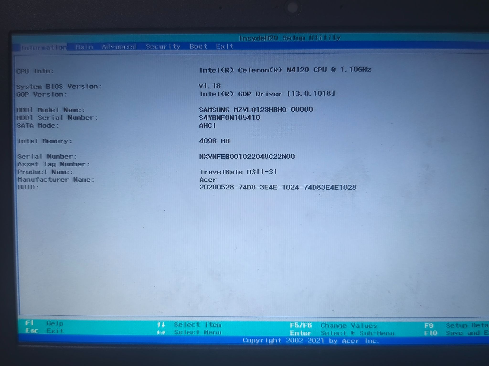
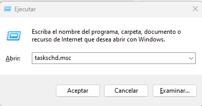

# Actividades

## Módulo 369: Implantación de Sistemas

### Introducción a sistemas

**Ciclo formativo:** Grado Superior — Administración de sistemas\
**Modalidad:** Presencial\
**Alumno:** David Blanco

## Introducción

Conocer Windows es esencial, ya que es uno de los sistemas operativos más utilizados en el mundo. Dominar su uso facilita la gestión de tareas cotidianas, la productividad en entornos laborales y la administración de sistemas, siendo clave para interactuar con una amplia variedad de software y redes empresariales.

### Objetivos de la actividad

* Reconocer la arquitectura de un sistema informático y hacer uso de un SO Windows.

### Entrega

* **Formato:** PDF.
* **Fecha límite:** la que muestre el campus.
* **Dedicación estimada:** 90 minutos.
* **Documentos de referencia:** Apuntes Sistemas (GitBook) y campus.

### Resultados de aprendizaje

* **RA1.** Instal·la sistemes operatius, analitzant-ne les característiques i interpretant-ne la documentació tècnica.

### Criterios de evaluación

* **1.1.** Identifica els elements funcionals d’un sistema informàtic.
* **1.2.** Identifica les característiques, funcions i arquitectura d’un sistema operatiu.
* **1.3.** Compara diferents sistemes operatius, les seves versions i llicències d’ús, en funció dels requisits, característiques i camps d’aplicació.
* **1.8.** Elabora documentació de suport relativa a les instal·lacions efectuades i les incidències detectades.

### Normas de evaluación

* Respuestas completas a las preguntas y bien desarrolladas.
* Cuidar el aspecto del documento.
* Las faltas de ortografía graves pueden descontar.
* Nombre del fichero en el mismo formato que se recibe: `M8UF3AX_NombreApellido.PDF`.
* Documento en PDF; de no ser así, no se califica (0 puntos).
* Si se sospecha que las capturas no son propias, 0 puntos.
* Por cada día fuera del plazo de entrega: −1 punto.
* Actividades iguales: 0 puntos.
* Si hay sospechas de uso de IA, se puede invalidar la respuesta.
* Añadir webgrafía y referencias para una mejor demostración.

***

## 1. Arquitectura

**Enunciado \[1 punto].** Como se comentó en clase, el BIOS (o EFI en su evolución) es el sistema encargado del arranque del hardware y de ceder el control al sistema operativo. Entrar al menú SETUP de la BIOS/UEFI del ordenador y responder:

**¿Con qué tecla has accedido?**

Con la tecla **F2**.

**¿Qué modelo de placa base tienes? ¿Y qué modelo de UEFI?**

* Modelo de placa base: **Acer Travelmate B311-31**.
* Modelo UEFI: **Insyde H20 Setup Utility**.

**Adjunta una fotografía** de la pantalla de BIOS/UEFI, tomada con el móvil si se desea, procurando que se vea bien y que no aparezca nada más.

**Menciona cuatro características o utilidades significativas y configurables de la BIOS/UEFI:**

1. **Boot Priority (orden de arranque):** permite cambiar el orden para iniciar desde un pendrive USB o el disco duro.
2. **Supervisor / User Password (seguridad):** permite establecer contraseñas de acceso a la BIOS o al encendido del equipo.
3. **Intel Virtualization Technology:** opción para activar la virtualización por hardware necesaria para máquinas virtuales.
4. **System Date & Time (fecha y hora del sistema):** permite configurar la hora y fecha de la placa base.

***

## 2. Sistema

Vamos a programar una tarea en Windows para que se ejecute automáticamente.

### 2.1. Crear una tarea de desfragmentación semanal \[1 punto]

Abrir **Inicio > Ejecutar** y escribir `taskschd.msc`.

Crear una tarea básica de desfragmentación con estos requisitos:

* Programa: `C:\Windows\System32\Defrag.exe`
* Argumento: `-c`
* Frecuencia: semanal.
* Día y hora: domingos a las 00:00.
* Ejecutar solo cuando el usuario haya iniciado sesión.
* Ejecutar con los privilegios más altos.

**Proceso paso a paso:**

1. **Abrir el Programador de tareas.** Pulsar **Windows + R**, escribir `taskschd.msc` y pulsar Aceptar.
2. **Crear una tarea básica.** En el panel de la derecha, seleccionar «Crear tarea básica». En el campo Nombre, introducir, por ejemplo, **desfragmentación semanal**. La descripción es opcional; después, pulsar Siguiente.

3. **Configurar el desencadenador.** Seleccionar «Semanalmente». Configurar la fecha de inicio, establecer la hora en **00:00:00** y seleccionar únicamente el día **Domingo**. Pulsar Siguiente.

4. **Configurar la acción.** Seleccionar «Iniciar un programa». En «Programa o script», introducir `C:\Windows\System32\Defrag.exe`. En «Agregar argumentos (opcional)», escribir `-c`, que indica que debe analizar y desfragmentar todos los volúmenes del sistema. Pulsar Siguiente.

5. **Configurar privilegios y condiciones.** Marcar la opción para abrir las propiedades avanzadas al finalizar. En la pestaña General, configurar que se ejecute solo cuando el usuario haya iniciado sesión y activar «Ejecutar con los privilegios más altos». Pulsar Aceptar para guardar la tarea.

### 2.2. Preguntas sobre desfragmentación \[2 puntos]

**¿Para qué sirve la utilidad de desfragmentar discos?**

Sirve para reorganizar los fragmentos de archivos que se encuentran dispersos por el disco duro mecánico (HDD). Al juntar las partes de cada archivo de forma secuencial, se optimiza el tiempo de lectura de los cabezales del disco, mejorando el rendimiento general y la velocidad de acceso a la información.

**¿Es necesaria la desfragmentación en sistemas Linux? Investiga, ¿por qué?**

No es necesaria la desfragmentación en sistemas Linux porque los sistemas de archivos modernos, como ext4, utilizan técnicas avanzadas de asignación de espacio (como los extents y la reserva anticipada de bloques) que dispersan de forma inteligente los archivos y dejan espacio libre a su alrededor, lo que previene activamente la fragmentación de manera nativa.

**¿Se te ocurre alguna otra tarea relevante que pudieras programar?**

Programar una copia de seguridad automática semanal de las carpetas de usuario más críticas o configurar una limpieza automática de archivos temporales del sistema de forma mensual.

**¿Es lo mismo la desfragmentación que la descompresión y la desempaquetación? ¿Tienen algún punto en común?**

No, no es lo mismo. La desfragmentación reorganiza bloques de datos dentro de una misma unidad de almacenamiento física para acelerar su lectura. La descompresión revierte el algoritmo matemático que redujo el tamaño de uno o varios archivos, mientras que la desempaquetación consiste en separar un fichero único que agrupaba a muchos otros en su interior sin alterar necesariamente su compresión. Su punto en común es que las tres son operaciones de gestión y manipulación orientadas a optimizar, organizar o recuperar la estructura original en la que se almacenan los datos.

### 2.3. Atajos de Windows \[0,5 puntos]

| Atajo                       | Uso                                                                           |
| --------------------------- | ----------------------------------------------------------------------------- |
| Windows + .                 | Abre el panel de emojis y símbolos.                                           |
| Windows + flechas (← ↑ ↓ →) | Organiza y ajusta ventanas en la pantalla rápidamente.                        |
| Windows + M                 | Minimiza todas las ventanas abiertas.                                         |
| Windows + Shift + S         | Hace capturas de pantalla y abre la herramienta Recortes.                     |
| Windows + E                 | Abre directamente el Explorador de archivos.                                  |
| Windows + I                 | Abre la Configuración del sistema operativo.                                  |
| Windows + 1, 2, 3, 4        | Abre o cambia rápidamente entre los programas anclados en la barra de tareas. |
| Windows + D                 | Muestra u oculta el escritorio.                                               |
| Windows + P                 | Abre el panel de proyección y permite configurar la duplicación de pantalla.  |
| Windows + «+» o «−»         | Abre y controla la Lupa de Windows.                                           |

### 2.4. Comandos de «Ejecutar» \[0,5 puntos]

Windows + R permite acceder a programas del sistema y aplicaciones. Comprobar qué utilidades abren los siguientes comandos y adjuntar una captura del resultado:

| Comando        | Utilidad                                                                                                                                                                                                                                                                                                            |
| -------------- | ------------------------------------------------------------------------------------------------------------------------------------------------------------------------------------------------------------------------------------------------------------------------------------------------------------------- |
| `temp`         | 
Abre la carpeta de archivos temporales de Windows para eliminar datos acumulados e innecesarios que ocupan espacio en el disco.  

 |
| `cmd`          | 
Ejecuta comandos de texto y permite controlar funciones de Windows sin usar el ratón.   

    

                                     |
| `msconfig`     | 
Abre la herramienta de configuración del sistema en Windows.  

  

                                                                 |
| `regedit`      | 
Abre el Editor del Registro de Windows.   

                                                                                       |
| `services.msc` | 
Abre la consola del administrador de servicios de Windows.  

 
                                                             |

## 3. Aplicaciones \[0,5 puntos]

Completar brevemente y con palabras propias el uso de varias aplicaciones necesarias para el ciclo y las consideraciones de instalación.

| Aplicación                 | Uso                                                                                                                                                                                                           | Consideraciones en la instalación                                                                                                                                                                                                                                                                                                                                                             |
| -------------------------- | ------------------------------------------------------------------------------------------------------------------------------------------------------------------------------------------------------------- | --------------------------------------------------------------------------------------------------------------------------------------------------------------------------------------------------------------------------------------------------------------------------------------------------------------------------------------------------------------------------------------------- |
| **7-Zip**                  | Compresor y gestor de archivos de código abierto y alta compresión. Comprime y descomprime formatos como .7z, .zip, .rar, .tar y .iso, y permite proteger archivos con cifrado AES-256.                       | Compatible con Windows (desde Windows 2000 hasta Windows 11) y arquitecturas x86, x64 o ARM64. Requiere muy poca memoria RAM. Enlace: https://www.7-zip.org/                                                                                                                                                                                                                                  |
| **Cisco Packet Tracer v8** | Herramienta de simulación de redes de Cisco para diseñar, configurar, probar y solucionar problemas en topologías con routers, switches, ordenadores y conexiones virtuales, sin hardware físico real.        | Requiere un sistema compatible (Windows 8.1/10/11 de 64 bits, Linux Ubuntu o macOS), procesador de 2,5 GHz o superior, al menos 4 GB de RAM y unos 1,4 GB libres. Para el primer inicio y el uso completo exige iniciar sesión con una cuenta gratuita de Cisco Networking Academy (NetAcad) o credenciales de NetAcad/Skills For All. Enlace: https://www.netacad.com/es/cisco-packet-tracer |
| **Wireshark**              | Analizador de protocolos de código abierto. Captura y examina en tiempo real el tráfico de red para diagnosticar problemas, analizar fallos de seguridad y auditar protocolos.                                | Compatible con Windows de 64 bits, macOS y distintas distribuciones de Linux. Se recomienda un procesador moderno, al menos 4 GB de RAM y espacio en disco según el tamaño de las capturas. En Windows es muy recomendable instalar o actualizar **Npcap**, controlador necesario para interceptar el tráfico de las interfaces de red. Enlace: https://www.wireshark.org/                    |
| **Git**                    | Sistema distribuido de control de versiones de código abierto que rastrea cambios en el código fuente, facilita el trabajo colaborativo y conserva el historial de proyectos; se integra con GitHub o GitLab. | Disponible para Windows, macOS y Linux, con requisitos de hardware ligeros. En Windows se recomienda configurar el editor predeterminado (por ejemplo, VS Code) y la conversión de finales de línea (_Line Ending Conversions_) para evitar incompatibilidades entre sistemas. Enlace: https://git-scm.com/                                                                                   |
| **Notepad++**              | Editor avanzado y ligero de código fuente y texto plano para Windows, alternativa al Bloc de notas. Admite varios lenguajes mediante resaltado de sintaxis, pestañas y extensiones.                           | Disponible para Windows de 32 y 64 bits, con consumo mínimo de CPU y RAM. La instalación es rápida; se recomienda mantener las opciones predeterminadas para integrar el programa en el menú contextual del Explorador. Enlace: https://notepad-plus-plus.org/                                                                                                                                |
| **VirtualBox**             | Software de virtualización de Oracle que permite crear y ejecutar máquinas virtuales con diferentes sistemas operativos, aisladas dentro de un equipo físico (host).                                          | Requiere un procesador compatible con virtualización por hardware (Intel VT-x o AMD-V), activada en BIOS/UEFI; se recomiendan al menos 4 GB de RAM y espacio suficiente para los discos virtuales. La instalación puede interrumpir temporalmente la conexión de red al instalar controladores virtuales, como Oracle VM VirtualBox Host-Only Network. Enlace: https://www.virtualbox.org/    |
| **Visual Studio Code**     | Entorno de desarrollo integrado ligero y extensible de Microsoft para escribir, depurar y editar código de varios lenguajes, con extensiones, terminal integrada y control de versiones Git.                  | Compatible con Windows, Linux y macOS. Requiere procesador de 1,5 GHz o superior, al menos 1 GB de RAM y espacio libre moderado. Se aconseja activar la opción de añadir al PATH y «Abrir con Code» en el menú contextual. Enlace: https://code.visualstudio.com/                                                                                                                             |
| **Docker**                 | Plataforma basada en contenedores que empaqueta, despliega y ejecuta aplicaciones con sus dependencias en entornos aislados, para que funcionen de forma consistente entre máquinas.                          | En Windows requiere virtualización habilitada en BIOS y el subsistema de Windows para Linux (WSL 2), además de un mínimo de 4 GB de RAM. Tras la instalación y el reinicio requerido, hay que configurar e iniciar Docker Desktop. Enlace: https://www.docker.com/                                                                                                                            |

### 3.1. Instalación múltiple con Winutils \[1,5 puntos]

La utilidad Winutils permite instalar varias aplicaciones de una vez.

**Guía paso a paso:**

1. **Acceso a Winutils.** Acceder al entorno mediante el comando de ejecución correspondiente en PowerShell con privilegios de administrador, o mediante su interfaz orientada a la gestión de paquetes y selección de utilidades («Tweaks & Apps»).

2. **Selección de aplicaciones.** En el catálogo de software, marcar las aplicaciones necesarias para el ciclo, como 7-Zip, Notepad++, Git, Visual Studio Code, VirtualBox, Docker, etc.

3. **Ejecución de la instalación automatizada.** Una vez seleccionadas las aplicaciones, pulsar el botón de instalación o ejecutar el comando de despliegue. La herramienta procesa la cola de paquetes, descargándolos e instalándolos secuencialmente y de forma desatendida en segundo plano.

4. **Identificación de errores y resolución.** Durante una instalación por lotes puede fallar alguna aplicación si el repositorio remoto sufre interrupciones o si el paquete necesita dependencias que no pueden resolverse automáticamente, por ejemplo, servicios de virtualización o reinicios pendientes. Winutils muestra un aviso en la consola o en el registro. La solución aplicada consiste en omitir el paquete conflictivo de la instalación masiva e instalarlo manualmente o de forma individual después.

### 3.2. Comando winget \[1,5 puntos]

Vídeo de referencia: https://youtu.be/WWxsyF2PwbA?si=ORzSbT6gD22sHHAB

El vídeo explica el comando `winget`. Respuestas:

**¿Para qué sirve el parámetro `-source`? Haz un ejemplo.**

El parámetro `-source` sirve para especificar explícitamente el repositorio u origen desde el cual se desea buscar, instalar o gestionar una aplicación.

Ejemplo de uso: `winget install --id Mozilla.Firefox --source winget`.

**¿Para qué sirve el término `| clip`?**

Redirige toda la salida de texto generada por un comando directamente al portapapeles de Windows. Permite copiar grandes listados de forma automática sin seleccionarlos manualmente con el ratón.

**¿Qué hace el parámetro `-upgrade-available`?**

Filtra la lista de aplicaciones instaladas para mostrar exclusivamente aquellas que tienen una actualización pendiente o una versión más reciente disponible en el repositorio oficial.

**¿Cómo hago para que aparezca la ayuda o guía de parámetros del comando?**

Añadir el modificador de ayuda `--help` o `-?` al final del comando o subcomando.

##

## 4. Polémicas de Windows 11 \[1,5 puntos]

Noticias de referencia indicadas en el documento:

* «Windows 11 tendrá una herramienta que analizará todo lo que haces con tu PC (incluso lo que escuches): así funcionará Recall en Copilot+» — Genbeta.
* «Recogida de cable: Microsoft hace cambios importantes a la característica “Recall” de Copilot+ tras el aluvión de críticas» — Geektopia.
* «Bugs: Microsoft confirma que los usuarios no podrán desinstalar la función más polémica de Windows 11» — ADSLZone.

### 4.1. ¿De dónde viene la polémica? ¿Qué es Recall? ¿Qué opinas?

La polémica surge por los graves riesgos para la privacidad y la seguridad informática. La herramienta recopila información íntima de forma masiva y se almacena en bases de datos locales vulnerables a ataques o software malicioso, sumado a la imposibilidad inicial de desinstalarla y a la falta de transparencia de Microsoft.

Recall es una función de inteligencia artificial para ordenadores con Windows 11 que toma capturas de pantalla de forma continua y periódica de todo lo que hace el usuario. Su objetivo es crear una «memoria fotográfica» navegable para buscar o recordar cualquier actividad pasada en el equipo.

Aunque tecnológicamente representa una innovación llamativa en el ámbito de la IA, su enfoque inicial demostró ser deficiente en la protección de datos por diseño. Permitir que un sistema operativo capture y almacene continuamente la actividad del usuario genera una vulnerabilidad innecesaria. Es fundamental que prevalezcan el control estricto del usuario y la privacidad frente a funciones de telemetría invasivas; por ello, se considera acertada la rectificación exigida a Microsoft por la comunidad técnica.

### 4.2. Debloat y bloatware: significado y configuración propuesta

Winutils incluye una opción «debloat» en el menú «Tweaks». El programa también permite crear una imagen de Windows 11 con debloat.

**Bloatware** es el conjunto de aplicaciones preinstaladas en un sistema operativo o dispositivo por el fabricante o Microsoft que el usuario normalmente no ha solicitado. Puede incluir aplicaciones comerciales, juegos, versiones de prueba de antivirus o utilidades de telemetría que consumen recursos innecesarios —RAM, espacio en disco y ciclos de CPU— y pueden ralentizar el equipo.

**Debloat** es el proceso de eliminar o deshabilitar software preinstalado innecesario (bloatware), así como desactivar funciones de telemetría, Cortana, widgets o aplicaciones en segundo plano, para optimizar el rendimiento, mejorar la privacidad y aligerar el sistema operativo.

**Configuración de debloating y eliminación de bloatware propuesta:**

1. **Ajustes de privacidad y esenciales.** Aplicar bloqueos estrictos para desactivar la telemetría, el envío de datos de diagnóstico y la publicidad molesta del menú Inicio, además de desactivar funciones de IA que no se suelen utilizar, como Copilot.
2. **Limpieza de bloatware.** Eliminar las aplicaciones preinstaladas de fábrica que no se usan, conservando las herramientas esenciales del sistema, como la Calculadora o la Tienda, para no perjudicar las actualizaciones de Windows.
3. **Mejoras de rendimiento.** Desactivar asistentes como Cortana y evitar que muchas aplicaciones innecesarias se ejecuten en segundo plano, para liberar memoria RAM y reducir el uso del procesador.

***

## Webgrafía y referencias

* Apuntes Sistemas (GitBook).
* Campus del ciclo formativo.
* 7-Zip: https://www.7-zip.org/
* Cisco Packet Tracer: https://www.netacad.com/es/cisco-packet-tracer
* Wireshark: https://www.wireshark.org/
* Git: https://git-scm.com/
* Notepad++: https://notepad-plus-plus.org/
* VirtualBox: https://www.virtualbox.org/
* Visual Studio Code: https://code.visualstudio.com/
* Docker: https://www.docker.com/
* Vídeo de referencia sobre winget: https://youtu.be/WWxsyF2PwbA?si=ORzSbT6gD22sHHAB
* Noticias sobre Recall: Genbeta, Geektopia y ADSLZone (referencias indicadas en el documento original).

***

**Nota sobre el traslado:** se ha pasado a texto el contenido legible del PDF, manteniendo sus apartados, preguntas, respuestas, tablas y enlaces. Las fotografías y capturas insertadas en el PDF original no se pueden recuperar desde la extracción de texto, por lo que se han señalado los lugares donde el documento original las solicitaba o incluía.
